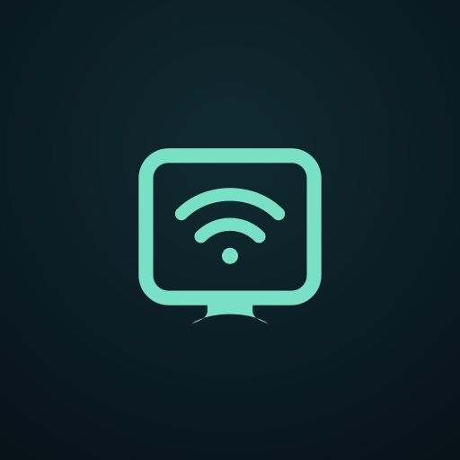

<p align="center"></p>

<h1 align="center">AirBridge</h1>

<p align="center">An open-source AirPlay receiver for Android phones, tablets and TVs.</p>

## Features

- Mirror an iPhone, iPad or Mac display over the local network.
- Receive AAC, AAC-ELD and Apple Lossless (ALAC) audio.
- Low-latency audio with a bounded priority worker, smaller AudioTrack buffer,
  partial-write recovery and Android low-latency playback mode where supported.
- H.264/H.265 video, native resolution, 30/60 fps, and Fit/Fill/Stretch modes.
- AirPlay video playback, Now Playing metadata and cover art.
- Optional PIN protection and approval prompts for new devices.
- Android TV / Google TV support and D-pad navigation.
- Built-in signed updates from this repository's GitHub Releases.
- Unlimited sessions, no ads and no tracking.

## Install

Download the latest signed APK from [Releases](https://github.com/chatLooney/AirBridge-Receiver/releases).
The in-app updater checks the same release feed. Android will ask you to allow installs
from AirBridge the first time you install an update.

## Build

Requirements: JDK 17, Android SDK, NDK `27.0.12077973`, CMake `3.22.1`, Perl,
Python 3, Make and Patch.

```sh
git clone https://github.com/chatLooney/AirBridge-Receiver.git
cd AirBridge-Receiver
git submodule update --init --recursive
./gradlew :app:testDebugUnitTest :app:assembleDebug
```

The first native build compiles OpenSSL and can take several minutes.

## Important limitations

- DRM-protected content such as Netflix, Disney+ and Apple TV+ cannot be mirrored
  because of FairPlay DRM.
- AirPlay 2 multi-room and HomeKit are not implemented.
- Sender behavior varies by Apple OS version, so real-device testing is required.

## Privacy

AirBridge does not collect personal data. Media travels directly between devices on
your local network. GitHub is contacted only when checking for an app update.

## Open source and attribution

AirBridge is licensed under **GPL-3.0-or-later**. It is derived from
[ScreenDock](https://github.com/tarek369/screendock) and uses the
[UxPlay](https://github.com/FDH2/UxPlay) receiver core. See `LICENSE` and `NOTICE`.

AirBridge is independent and is not affiliated with or endorsed by Apple.
AirPlay, iPhone, iPad and Mac are trademarks of Apple Inc.

<p align="center">Created by Looney</p>
